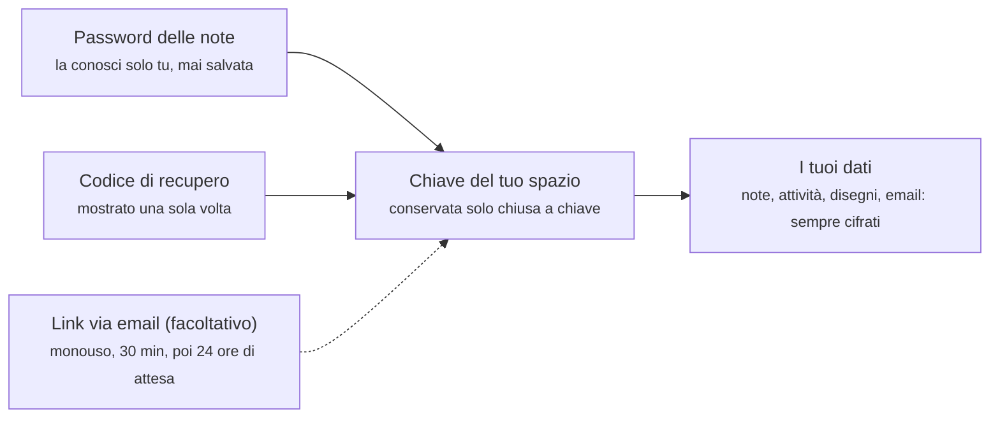

# ZNoteKeeper – Presentazione per l'utente

24 novembre 2026 · Documento di presentazione (versione condivisibile: [Claude Doc](https://claude.ai/artifact/3U7gBBJHS8VibchwUgoeRt))

## Cos'è ZNoteKeeper

ZNoteKeeper è un taccuino privato con lista delle attività, che vive sul tuo sito WordPress e si usa dal telefono o dal PC come un'app. Tutto ciò che scrivi viene chiuso a chiave con una password che scegli tu: nemmeno l'amministratore del sito può leggerlo.

In un solo posto trovi:

- **Taccuino**: note organizzate in gruppi, sezioni e pagine, come un quaderno ad anelli con le schede colorate.
- **Attività**: liste di cose da fare con scadenze, ripetizioni e sotto-attività.
- **Disegni**: schizzi a mano libera dentro le note e le attività.
- **Email → nota**: inoltri un'email a un indirizzo personale e diventa una nota.
- **App sul telefono e sul PC**: si installa sulla schermata Home o sul computer, si apre in una finestra propria e funziona anche senza rete.

Puoi provare tutte le schermate nel mockup interattivo: [`docs/mockup/znotekeeper-mockup.html`](mockup/znotekeeper-mockup.html) (aprilo nel browser).

## Accesso e primo avvio

Per usare ZNoteKeeper serve il via libera dell'amministratore del sito, poi ogni persona ha il proprio spazio separato. Note, attività, disegni ed email di un utente non sono visibili agli altri utenti né all'amministratore.

**Cosa fa l'amministratore**

- Da **Utenti › ZNoteKeeper** nel pannello di WordPress abilita o disabilita i singoli utenti.
- Vede solo chi è abilitato, da quando e quanto spazio occupa. Non vede titoli né contenuti.
- Può togliere l'accesso o cancellare lo spazio di un utente, ma non può aprirlo né cambiarne la password.

**Cosa fa l'utente al primo avvio**

1. Accede al sito con il suo solito utente WordPress e apre ZNoteKeeper.
2. Sceglie la **password delle note**: è diversa da quella di WordPress e serve ad aprire il proprio spazio. Un indicatore mostra quanto è robusta.
3. Riceve il **codice di recupero**, lo salva (stampa, download o gestore di password) e ne riscrive alcuni caratteri per confermare di averlo conservato.
4. Se vuole, attiva anche il **recupero via email** (vedi la sezione successiva).
5. Installa l'app sul telefono o sul PC e, se lo desidera, attiva lo sblocco con impronta o volto.

La password delle note non viene mai salvata da nessuna parte, neppure cifrata: il sistema conserva solo una sua «impronta» che permette di riconoscerla, non di ricostruirla.

## Password e recupero

I tuoi dati sono chiusi da una chiave segreta creata solo per te. Quella chiave viene conservata soltanto «chiusa a chiave», e si apre in tre modi: con la password, con il codice di recupero o, se l'hai attivato, con un link via email.

Se dimentichi la password non perdi nulla, purché tu abbia il codice di recupero. L'amministratore non entra mai in nessuno dei tre percorsi.

**Codice di recupero (consigliato)**

- È una sequenza di 24 caratteri, per esempio `K7QM-2XPA-9RTE-H4WN-B6CY-JD3F`, mostrata una sola volta.
- Con il codice scegli una nuova password e ritrovi tutto. Subito dopo ricevi un codice nuovo e quello vecchio smette di funzionare.
- Puoi generarne uno nuovo in qualsiasi momento da Impostazioni › Sicurezza.
- Conservalo fuori dal telefono: su carta in un posto sicuro o in un gestore di password.

**Link via email (facoltativo)**

Il link è comodo ma meno riservato del codice, perché chi controlla la tua casella e il server potrebbe usarlo. Per questo è spento finché non lo attivi e ha diverse protezioni:

- Funziona solo se hai già effettuato l'accesso a WordPress con il tuo utente.
- Vale una sola volta e scade dopo 30 minuti.
- Dopo il clic parte un'**attesa di 24 ore**: ricevi un avviso via email e sui dispositivi già collegati, e puoi annullare il recupero se non l'hai chiesto tu.
- A recupero completato tutti gli altri dispositivi vengono scollegati.

**Se perdi sia la password che il codice** (e non hai attivato il link), i dati non si possono più aprire. È il prezzo della riservatezza: nessuno, nemmeno chi gestisce il sito, ha una copia della chiave. L'amministratore può solo cancellare lo spazio e farti ripartire da zero.

**Cambiare la password** è immediato: le note restano come sono, cambia solo la serratura che apre la chiave.

## Il Taccuino

Il Taccuino ordina le note su tre livelli: **gruppi di sezioni**, **sezioni** e **pagine**. È come un raccoglitore: i gruppi sono i divisori, le sezioni sono le schede colorate, le pagine sono i fogli.

| Livello | A cosa serve | Esempio |
| --- | --- | --- |
| Gruppo di sezioni | Raccoglie sezioni dello stesso ambito | Lavoro, Casa |
| Sezione | Un argomento, con un colore | Riunioni, Ricette |
| Pagina | Una nota | Lasagne della nonna |
| Sottopagina | Una nota legata a un'altra, rientrata sotto di essa | Note sulla cifratura |

**Cosa puoi fare**

- Aprire l'albero delle sezioni dal menu in alto a sinistra, chiudere e riaprire i gruppi.
- Creare gruppi e sezioni, scegliere il colore della sezione, rinominarle, spostare una sezione in un altro gruppo.
- Creare pagine, spostarle in un'altra sezione, trasformarle in sottopagine o eliminarle (con possibilità di annullare).
- Tenere sezioni fuori dai gruppi, come **Posta in arrivo** dove arrivano le email.

**Scrivere una pagina**

L'editor è visuale: scrivi e formatti come in un normale programma di videoscrittura, senza codici da ricordare. La barra in basso offre titoli, grassetto, corsivo, barrato, codice, elenchi puntati e numerati, caselle da spuntare, citazioni e l'inserimento di un disegno.

Il testo viene salvato in **Markdown**, un formato di testo semplice e aperto. Significa che le tue note restano leggibili con qualsiasi programma anche fuori da ZNoteKeeper, per esempio dopo un'esportazione. Il pulsante **Markdown** sulla pagina mostra il testo esattamente come viene salvato, prima di essere cifrato.

Le pagine si salvano da sole mentre scrivi.

## Le Attività

Le Attività sono liste di cose da fare con scadenze, pensate per essere spuntate al volo.

- **Liste**: ne crei quante vuoi (Personale, Lavoro, Da email) e passi dall'una all'altra con le schede in alto. Dal menu ⋯ della lista puoi rinominarla, eliminarla o cancellare in un colpo le attività completate.
- **Speciali**: la stella su un'attività la porta nella vista Speciali, che raccoglie le stelle di tutte le liste.
- **Scadenza**: data e, se serve, ora. Le scadute sono in rosso, quelle di oggi in arancio. All'ora indicata ricevi un promemoria.
- **Ripetizione**: ogni giorno, settimana, mese o anno. Quando completi un'attività ricorrente compare subito la successiva.
- **Sotto-attività**: un livello sotto l'attività principale, ciascuna da spuntare a parte.
- **Dettagli**: un campo di testo libero per appunti, salvato anch'esso in Markdown.
- **Completare**: tocchi il cerchio, l'attività scende in «Completate» e per qualche secondo puoi annullare.
- **Riordinare**: trascini la maniglia a sinistra. In alternativa ordini la lista per data di scadenza.
- **Spostare**: dal dettaglio sposti un'attività in un'altra lista.

## Disegnare nelle note

Puoi disegnare con il dito, un pennino, il mouse o una tavoletta grafica dentro una pagina del Taccuino o dentro un'attività.

- Strumenti: penna, evidenziatore trasparente e gomma.
- Sei colori e uno spessore regolabile.
- Annulla e ripristina tratto per tratto, oppure cancella tutto il foglio.
- **Salva** inserisce il disegno nella pagina nel punto in cui stavi scrivendo, o tra i disegni dell'attività.
- Toccando un disegno già salvato lo riapri e continui da dove eri rimasto.

Anche i disegni sono cifrati come il resto delle note.

## Email → nota

Ogni utente ha un indirizzo email personale, per esempio `note-7f3k9q@note.tuodominio.it`: inoltri un messaggio a quell'indirizzo e dopo qualche minuto lo ritrovi come nota.

- **Cosa viene importato**: l'oggetto diventa il titolo, il corpo diventa il testo. Allegati, immagini e firme grafiche vengono scartati.
- **Dove finisce**: lo scegli tu. Come nuova pagina in una sezione (di solito Posta in arrivo) oppure come nuova attività in una lista.
- **Chi può scrivere**: solo i mittenti che hai autorizzato, per esempio i tuoi indirizzi personali e di lavoro. Le email da altri indirizzi vengono scartate senza creare note.
- **Riservatezza**: l'email viene chiusa nella tua cassaforte appena arriva, anche se in quel momento non hai l'app aperta. Da quel momento la può leggere solo chi conosce la tua password.
- Le note arrivate via email hanno una busta accanto al titolo e indicano mittente e ora di arrivo.

## App sul telefono e sul PC, ricerca e blocco

**Installazione.** ZNoteKeeper si apre dal browser e si installa come una normale app, sia sul telefono sia sul computer.

- Android (Chrome): tocca **Installa app** nel banner o nel menu ⋮.
- iPhone (Safari): tocca **Condividi**, poi **Aggiungi alla schermata Home**. I promemoria delle scadenze arrivano solo se l'app è stata aggiunta così.

Una volta installata si apre a schermo intero e mostra le note già scaricate anche senza connessione.

**Sul PC.** Con Chrome o Edge si clicca l'icona **Installa** nella barra degli indirizzi: ZNoteKeeper compare nel menu Start o nel Launchpad e si apre in una finestra sua, senza schede né barra del browser. Lo schermo grande viene sfruttato a colonne:

- **Taccuino**: albero di gruppi e sezioni a sinistra, elenco delle pagine al centro, pagina aperta a destra.
- **Attività**: lista a sinistra e dettaglio dell'attività selezionata a destra, senza cambiare schermata.
- La navigazione passa in una barra verticale a sinistra; le finestre di conferma compaiono al centro.
- Scorciatoie da tastiera: **Ctrl+K** per cercare, **Ctrl+Maiusc+L** per bloccare (Cmd su Mac).
- Sul PC si disegna con il mouse, la tavoletta grafica o il touch screen.

I dati sono gli stessi su tutti i dispositivi: una nota scritta sul telefono si ritrova sul PC dopo lo sblocco.

**Ricerca.** Un'unica casella cerca nei titoli e nei testi di tutte le pagine e di tutte le attività, evidenziando le parole trovate.

**Blocco automatico.** Dopo un tempo di inattività che scegli tu (subito, 1, 5 o 15 minuti) l'app si richiude e chiede di nuovo la password, oppure l'impronta o il volto se li hai attivati. Il lucchetto in alto la chiude subito.

**Backup.** Da Impostazioni puoi scaricare una copia di tutto in un file cifrato, che si apre solo con la tua password.

## Casi d'uso

Ogni caso descrive chi agisce, cosa vuole ottenere e i passi nell'app.

| N. | Caso d'uso | Chi | Risultato |
| --- | --- | --- | --- |
| 1 | Abilitare un utente | Amministratore | L'utente vede ZNoteKeeper nel suo menu |
| 2 | Primo avvio e scelta password | Utente | Spazio personale pronto e codice di recupero salvato |
| 3 | Sbloccare l'app | Utente | Note e attività visibili sul dispositivo |
| 4 | Organizzare il taccuino | Utente | Gruppi e sezioni creati, pagine al loro posto |
| 5 | Scrivere una nota formattata | Utente | Pagina salvata in Markdown e cifrata |
| 6 | Disegnare in una nota | Utente | Schizzo inserito nella pagina |
| 7 | Gestire le attività | Utente | Attività con scadenza, ripetizione e sotto-attività |
| 8 | Trasformare un'email in nota | Utente | Nuova pagina o attività dall'email inoltrata |
| 9 | Recuperare l'accesso | Utente | Nuova password, dati intatti |
| 10 | Togliere l'accesso a un utente | Amministratore | L'utente non apre più ZNoteKeeper |

**1. Abilitare un utente.** L'amministratore apre Utenti › ZNoteKeeper, cerca l'utente e attiva l'interruttore. L'utente riceve un'email che lo invita al primo avvio.

**2. Primo avvio.** L'utente apre ZNoteKeeper, sceglie la password delle note e la ripete. Salva il codice di recupero e ne riscrive quattro caratteri per conferma. Decide se attivare il recupero via email. Il Taccuino si apre con una sezione Posta in arrivo e una lista Personale già pronte.

**3. Sbloccare l'app.** Apre l'app dalla Home del telefono o dal menu Start del PC e appoggia il dito o guarda lo schermo. Se la biometria non è attiva, scrive la password.

**4. Organizzare il taccuino.** Apre il menu delle sezioni, crea il gruppo Casa e al suo interno la sezione Ricette in arancione. Sposta la pagina Lasagne della nonna da Posta in arrivo a Ricette.

**5. Scrivere una nota.** Tocca + Pagina, dà un titolo, aggiunge un titoletto Ingredienti, un elenco puntato e alcune caselle da spuntare per la spesa. Non deve salvare: lo fa l'app mentre scrive.

**6. Disegnare.** Nella pagina di una riunione tocca la penna nella barra, schizza lo schema discusso con l'evidenziatore giallo sui punti importanti e salva. Il disegno compare nel testo.

**7. Gestire le attività.** Aggiunge Rinnovare assicurazione auto con scadenza tra quattro giorni, ripetizione annuale e due sotto-attività. Quando la completa, la scadenza dell'anno prossimo compare da sola.

**8. Email → nota.** Inoltra la conferma di un hotel all'indirizzo personale. Dopo qualche minuto trova la pagina in Posta in arrivo con oggetto come titolo e testo dell'email, senza allegati.

**9. Recuperare l'accesso.** Ha dimenticato la password. Nella schermata di sblocco tocca Password dimenticata, inserisce il codice di recupero e sceglie una nuova password. Riceve subito un nuovo codice da salvare. In alternativa usa il link via email e attende 24 ore.

**10. Togliere l'accesso.** L'amministratore spegne l'interruttore dell'utente. I dati restano cifrati e possono essere riattivati, oppure cancellati definitivamente su richiesta.

## Domande frequenti

**L'amministratore del sito può leggere le mie note?** No. Può abilitarti, disabilitarti o cancellare il tuo spazio, ma i contenuti per lui sono illeggibili.

**La password delle note è la stessa di WordPress?** No, sono due password separate. Quella di WordPress ti fa entrare nel sito, quella delle note apre il tuo spazio.

**Cosa succede se perdo il telefono?** Le note sul telefono sono cifrate e l'app si blocca da sola. Da un altro dispositivo puoi scollegare quello perso da Impostazioni › Sicurezza.

**Posso usarlo anche dal computer?** Sì, e conviene installarlo come app: su schermo grande l'interfaccia mostra sezioni, elenco e pagina affiancati.

**Quali informazioni non sono cifrate?** Solo quelle che servono a ordinare e ad avvisarti: le date di scadenza, lo stato completato, l'ordine e il colore delle sezioni. Titoli, testi, disegni ed email sono sempre cifrati. L'elenco definitivo sarà fissato nell'analisi.

**Posso portare via le mie note?** Sì, con il backup cifrato. Il testo, essendo in Markdown, resta leggibile anche con altri programmi una volta decifrato.

## Glossario

| Termine | Significato |
| --- | --- |
| Cifratura | Trasformare un testo in una sequenza illeggibile che si riapre solo con la chiave giusta |
| Password delle note | La password che scegli tu per aprire il tuo spazio, diversa da quella di WordPress |
| Codice di recupero | Codice di 24 caratteri che sostituisce la password se la dimentichi |
| Markdown | Formato di testo semplice con simboli leggeri (# per i titoli, - per gli elenchi) |
| PWA | Sito che si installa su telefono o PC e si comporta come un'app |
| Sezione | Scheda colorata del taccuino che contiene pagine |
| Gruppo di sezioni | Contenitore che raccoglie più sezioni |
